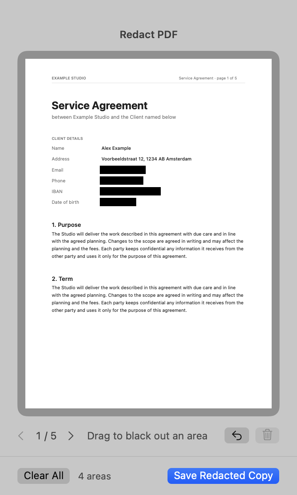
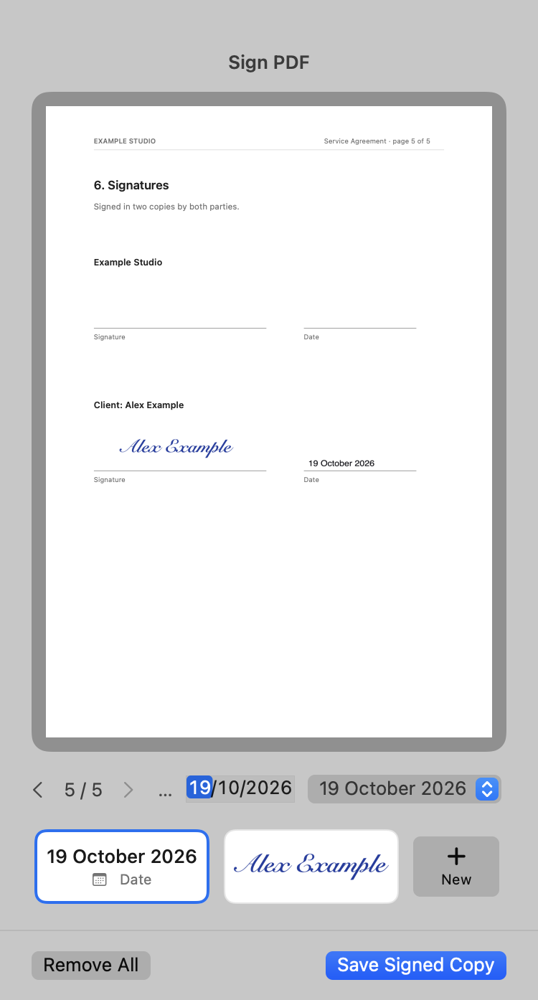
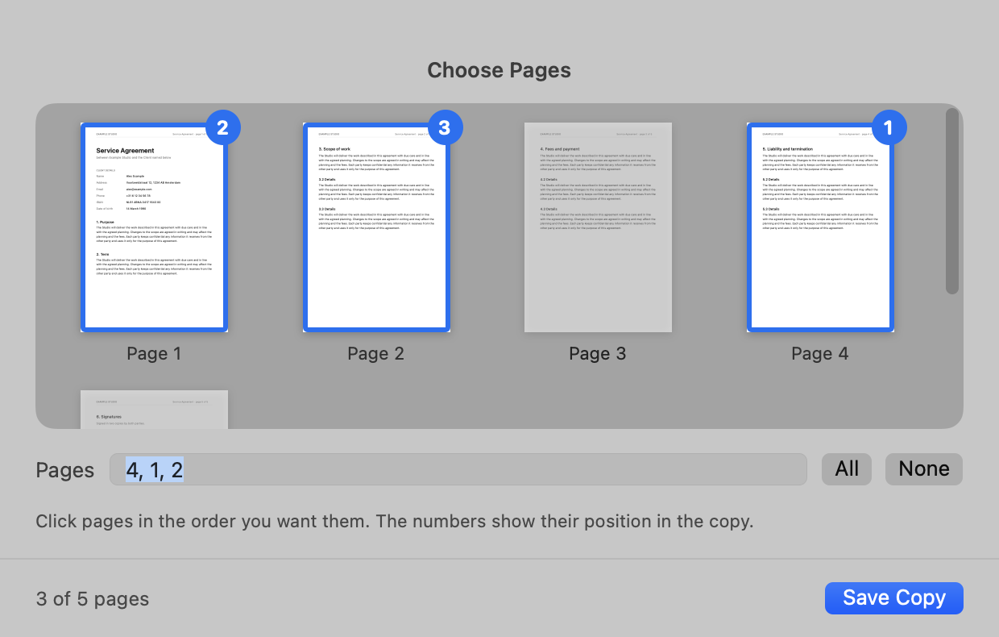
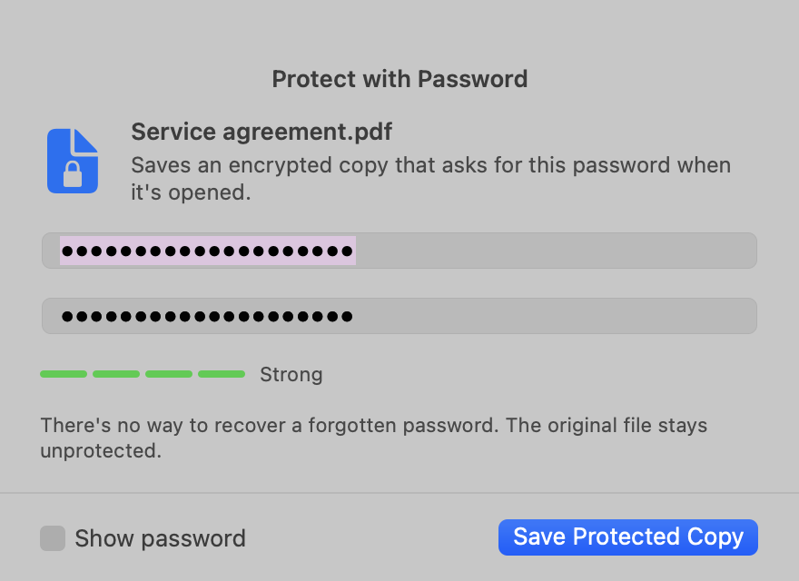

<p align="center">
  
</p>

<h1 align="center">Convert</h1>

<p align="center">
  <b>Convert, edit and sign files right from Finder, and paste from your clipboard history in any app.</b><br>
  A small menu bar app for macOS. Middle-click a file and pick a format from a glass wheel.
</p>

<p align="center">
  <a href="#install">Install</a> ·
  <a href="#converting-files">Converting</a> ·
  <a href="#editing-images-and-pdfs">Editing</a> ·
  <a href="#clipboard-history">Clipboard history</a> ·
  <a href="#supported-formats">Formats</a> ·
  <a href="#privacy">Privacy</a> ·
  <a href="#faq--troubleshooting">FAQ</a>
</p>

<p align="center">
  
  
</p>

## Highlights

- **Convert in one gesture.** Press the scroll wheel on a file, flick toward a format and let go. The converted copy appears next to the original.
- **Many formats.** Images (JPG, PNG, HEIC, WebP, AVIF, GIF, TIFF), documents (TXT, Markdown, RTF, Word, HTML, PDF) and tables (CSV, TSV, PSV, Excel, JSON).
- **Edit without opening an app.** ⌘ + middle-click an image or PDF to crop, compress, black out (redact), sign, add a date, pick pages or add a password.
- **Clipboard history.** Press ⌃⌥V anywhere to paste one of your last 5 copies, or one of up to 3 pinned items.
- **Safe by design.** Originals are never changed. Everything runs on your Mac, with no accounts, uploads or tracking.
- **Native and light.** A real macOS app for Apple Silicon and Intel, a 7 MB download. It lives in the menu bar, not the Dock.

## Install

### With Homebrew (recommended)

```sh
brew tap ricardobroeders/convert https://github.com/Ricardobroeders/convert
brew install --cask ricardobroeders/convert/convert
```

Update later with:

```sh
brew upgrade --cask convert
```

### With the disk image

1. Download the latest `Convert-x.y.z.dmg` from [Releases](https://github.com/Ricardobroeders/convert/releases/latest).
2. Open it and drag **Convert** onto **Applications**.
3. Open Convert from Applications.

Convert isn't notarized by Apple yet, so the first time you open the downloaded app, macOS says it can't verify it. Go to **System Settings › Privacy & Security**, scroll down and click **Open Anyway**. You only need to do this once. The Homebrew install skips this step.

### Requirements

- macOS 14 Sonoma or later
- Apple Silicon or Intel Mac

### First launch

Convert appears as an icon in the menu bar (top right), not in the Dock. It asks for two permissions, each the first time it's needed:

| Permission | Why | Where |
|---|---|---|
| **Automation → Finder** | To see which files you've selected in Finder | macOS asks automatically the first time you open the wheel |
| **Accessibility** | To catch the scroll-wheel click on a file and to paste from the clipboard history for you | System Settings › Privacy & Security › Accessibility → turn on **Convert** |

Without Accessibility, everything else still works. You use the keyboard shortcut instead of middle-click. When you pick something from the clipboard history, Convert puts it on the clipboard and you press ⌘V yourself.

## Converting files

Select one or more files in Finder and open the wheel in whichever way you like:

| How | What you do |
|---|---|
| **Mouse: press and flick** | Press and hold the scroll wheel on a file, move toward a format, let go |
| **Mouse: click and click** | Click the scroll wheel on a file, then click a format |
| **Keyboard: hold and flick** | Hold **⌃⌥C** (Control-Option-C), move the pointer toward a format, let go |
| **Keyboard: tap and pick** | Tap **⌃⌥C**, then click a format, press **1–8** (clockwise from the top), or use the arrow keys and Return |

Press **Esc** or click outside the wheel to cancel.

**What happens next**

- The converted copy is saved **next to the original**, with the new extension: `photo.jpg` → `photo.webp`.
- The original is **never changed or overwritten**. If `photo.webp` already exists, the new file is called `photo 2.webp`.
- **Several files at once:** select them all and every file is converted. If they're different types, the wheel shows only the formats all of them can become.
- **Middle-click acts like right-click:** on a file that's part of your selection, the whole selection is converted; on any other file, just that one.
- Middle-click is only taken over **on files in Finder**. Folders, the desktop background and every other app keep their normal middle-click.
- ⌃⌥C only works while Finder is the frontmost app, so other apps keep that shortcut. You can change it from the menu bar icon.

## Editing images and PDFs

**⌘ + middle-click** an image or PDF to open the edit wheel. Each tool opens a small window with a live preview and saves a **new copy**, such as `photo cropped.jpg`, `contract signed.pdf` or `report pages 1-3.pdf`.

| Tool | Images | PDFs | What it does |
|---|:---:|:---:|---|
| [**Crop**](#crop) | ✓ | | Cut an image to a shape or exact size |
| [**Compress**](#compress) | ✓ | ✓ | Make files smaller, with a strength slider |
| [**Redact**](#redact) | ✓ | ✓ | Black out personal or confidential details for good |
| [**Sign**](#sign) | ✓ | ✓ | Place your signature and the date |
| [**Pages**](#pages) | | ✓ | Save a copy with only the pages you pick, in your order |
| [**Protect**](#protect) | ✓ | ✓ | Save a password-protected copy |

### Crop

Drag the corners or edges, or move the whole frame. Pick a shape (**Free, 1:1, 16:9, 9:16, 4:3 or 3:4**) or type an exact **width and height in pixels**. Useful for profile pictures, social posts and banners. The cropped copy keeps the original format and quality.

<p align="center">
  
</p>

### Compress

Move the slider from **Light** to **Maximum** and see the new file size and the result straight away, before you save.

- **Images:** you can also scale them down (3840 to 800 px on the longest side), choose the output format (JPG, WebP, HEIC, AVIF or PNG) and keep or strip metadata like location and camera.
- **PDFs:** the images inside are recompressed and scaled down, while text and vector graphics stay sharp and selectable. Handy for scans and presentations that are too big to email.

If a setting wouldn't make the file smaller, Convert says so and won't save a bigger copy.

<p align="center">
  
</p>

### Redact

Drag black boxes over anything that shouldn't be shared: names, addresses, account numbers, signatures, faces. Click a box to select it, then press ⌫ or click its ✕ to remove it. ⌘Z undoes the last box, and ← / → switch between PDF pages.

Redaction is **permanent** in the copy:

- **Images:** the pixels are replaced with black, and location and camera metadata is removed.
- **PDFs:** pages with boxes are flattened into an image, so the text underneath is really gone. It can't be selected, searched or copied out from under the box. Pages without boxes keep their normal, selectable text.

<p align="center">
  
</p>

### Sign

Sign contracts, addenda and forms without printing or scanning.

1. ⌘ + middle-click the PDF (or image) and choose **Sign**.
2. Click your signature tile, then click where it goes. Drag to move it, use the corner to resize it.
3. Click the **Date** tile and click next to your signature to add the date.
4. Go to other pages with ← / → if more initials or signatures are needed, then **Save Signed Copy**.

**Your signature**

- Draw it once on the signature pad (**+ New**) with the mouse or trackpad, in black or blue ink. It's ready every time after that.
- You can keep several, for example a full signature and your initials. Right-click one to delete it.
- Signatures are stored only on your Mac, in `~/Library/Application Support/Convert/Signatures`.

**The date**

- It's today by default, and you can pick any other date.
- Choose a style: `19-10-2026`, `19 October 2026` or `2026-10-19`. Dates follow your Mac's language, so Dutch gives `19 oktober 2026`.
- Changing the date or style updates the dates you've already placed.

The rest of the PDF stays as it was, with selectable text.

<p align="center">
  
</p>

### Pages

Save a new PDF with only the pages you need, **in the order you click them**. The numbers on the thumbnails show each page's position in the copy. You can also type ranges like `4, 1-2` or `1-3, 7`, or use **All** and **None**. Useful for sending one section of a long report, or moving an appendix to the front.

<p align="center">
  
</p>

### Protect

Save a copy that asks for a password when it's opened.

- Type a password of at least 4 characters twice. A meter shows how strong it is, and you can show the password to check it.
- **PDFs** get AES encryption. **Images** are saved as a password-protected PDF.
- The copy opens in Preview, Adobe Reader, browsers and every other PDF reader once the password is entered.
- The original stays unprotected. Convert doesn't keep the password, so **write it down**: a forgotten password can't be recovered.

<p align="center">
  
</p>

## Clipboard history


Copy as usual with ⌘C. Convert remembers your **last 5 copies**: text, images and screenshots, files from Finder, and formatted text.

Press **⌃⌥V** (Control-Option-V) in **any app** and a list opens at the pointer, newest first. Each row shows:

- a preview (the actual picture for copied images and screenshots),
- the text or file name,
- what it is, which app it came from, and how long ago.

**Pasting**

- **Hold ⌃⌥V**, move over a row and let go, or
- press **1–5**, or use **↑/↓** and **Return**, or click a row.

The item is pasted straight into the app you're working in and moves to the top. A plain ⌘V then pastes it again. ⌘V itself never changes: it always pastes your latest copy.

**Pinning**

Right-click a row, or highlight it and press **P**, to pin it. Use this for things you paste often, like your address, IBAN or a standard reply. Up to **3 pinned items** stay in a *Pinned* section (#6–8) no matter how much you copy afterwards.

**Privacy**

- The history is kept **in memory only**. It's never written to disk and disappears when Convert quits.
- Copies that password managers mark as secret are **never recorded**. That includes 1Password, Bitwarden, Apple's Passwords app and others that follow the [nspasteboard.org](http://nspasteboard.org) convention.
- Turn recording off with **Remember Copies** in the menu, or empty it with **Clear Clipboard History**.

<br clear="right">

## Supported formats

### Images

| From | To |
|---|---|
| **JPG** | PNG · WebP · AVIF · HEIC · GIF · TIFF · PDF |
| **PNG** | JPG · WebP · AVIF · HEIC · GIF · TIFF · PDF |
| **HEIC** (iPhone photos) | JPG · PNG · WebP · AVIF · TIFF · PDF |
| **WebP** | JPG · PNG · AVIF · HEIC · GIF · PDF |
| **AVIF** | JPG · PNG · WebP · HEIC · PDF |
| **GIF** | PNG · JPG · WebP · AVIF · PDF |
| **TIFF** | JPG · PNG · WebP · AVIF · HEIC · PDF |
| **BMP, RAW, PSD** and other images macOS can open | JPG · PNG · WebP · AVIF · HEIC · TIFF · PDF |

- The photo's rotation is applied, so pictures never come out sideways.
- Camera and location data is kept for JPG, HEIC, PNG and TIFF.
- Transparent areas become white in JPG.

### Documents and text

| From | To |
|---|---|
| **TXT** | Word (DOCX) · PDF · Markdown · RTF · HTML · JSON · CSV · JS |
| **Markdown** (MD) | Word · PDF · HTML · RTF · TXT |
| **Word** (DOCX) | PDF · TXT · RTF · HTML · ODT |
| **Word 97–2003** (DOC), **OpenDocument** (ODT) | DOCX · PDF · TXT · RTF |
| **RTF** | DOCX · PDF · TXT · HTML · ODT |
| **HTML** | PDF · DOCX · TXT · RTF |
| **JavaScript** (JS) | PDF · HTML · DOCX · RTF · TXT |
| **PDF** | PNG · JPG · WebP (one image per page) · TXT · DOCX · RTF |

- **Markdown:** headings, lists, bold, italics, links, quotes and code blocks are kept as real formatting in Word, PDF and HTML.
- **Code and JSON:** turned into a monospaced document with syntax colours.

### Tables and data

| From | To |
|---|---|
| **CSV** | Excel (XLSX) · TSV · PSV · JSON · PDF · DOCX · HTML · Markdown |
| **TSV** (tab-separated) | Excel · CSV · PSV · JSON · PDF · DOCX · HTML · Markdown |
| **PSV** (pipe-separated) | Excel · CSV · TSV · JSON · PDF · DOCX · HTML · Markdown |
| **Excel** (XLSX) | CSV · TSV · PSV · JSON · PDF · DOCX · HTML · Markdown |
| **JSON** | CSV · Excel · TSV · PSV · PDF · HTML · TXT |

- **Separators are detected automatically:** comma, semicolon (common in Dutch and European Excel exports), tab or pipe.
- **Numbers stay numbers** in Excel and JSON, while codes with leading zeros (`007`, postcodes) stay text.
- **Excel workbooks with several sheets** give one file per sheet: `report - Sheet2.csv`.
- **Excel values come through clean:** dates become real dates (`2026-10-19`), formulas give their calculated value, and rounding noise like `0.30000000000000004` becomes `0.3`.
- **PDF and Word get a proper table** with a header row, switching to landscape when there are more than 6 columns.
- **JSON → table:** a list of objects becomes rows, with columns in the order they appear in the file.

## The menu bar icon

Click the Convert icon in the menu bar for:

| Menu item | What it does |
|---|---|
| **Convert Finder Selection…** | Opens the wheel for the files selected in Finder |
| **Change Shortcut…** | Pick another shortcut instead of ⌃⌥C |
| **Middle-Click Files to Convert** | Turn the scroll-wheel trigger on or off |
| **Paste from Clipboard History** | Opens the clipboard list |
| **Remember Copies** | Turn clipboard history on or off |
| **Clear Clipboard History** | Forget all copies, including pins |
| **Open at Login** | Start Convert automatically when you log in |
| **Quit Convert** | Quit the app |

## Privacy

Convert works entirely on your Mac.

- **No network.** Files are converted locally with macOS's own frameworks plus the open-source libwebp and libavif libraries. Nothing is uploaded, and there are no accounts, analytics or ads.
- **Originals are never touched.** Every conversion and edit writes a new file next to the original.
- **Redaction is real.** Redacted areas are removed from the pixels (images) or the page is flattened (PDF), so the text underneath can't be selected or recovered.
- **Signatures** are stored only in your user folder, `~/Library/Application Support/Convert/Signatures`.
- **Clipboard history** is kept in memory only and skips anything password managers mark as secret.

## FAQ & troubleshooting

**Where is my converted file?**
In the same folder as the original, with the same name and the new extension. A short confirmation appears when it's done.

**Middle-click doesn't do anything.**
Allow Convert in **System Settings › Privacy & Security › Accessibility**. If it's already on, toggle it off and on again, or remove Convert with the **–** button and add it again. Check that middle-click is enabled in the Convert menu. It only works on files in Finder, not on folders or in other apps.

**I don't have a mouse with a scroll wheel.**
Select files in Finder and press **⌃⌥C**. Everything else works the same.

**⌃⌥C does nothing.**
The shortcut only works while Finder is the active app. The first time, macOS asks whether Convert may control Finder; if you clicked *Don't Allow*, turn it on in **System Settings › Privacy & Security › Automation › Convert › Finder**.

**Picking from the clipboard history doesn't paste.**
Pasting for you needs the Accessibility permission. Without it, the item is put on the clipboard and you press ⌘V.

**"Convert can't be opened because Apple cannot check it for malicious software."**
This happens with the DMG download because the app isn't notarized yet. Open **System Settings › Privacy & Security** and click **Open Anyway**, once. Installing with Homebrew avoids it.

**Which formats appear in the wheel?**
The formats the selected file (or *every* selected file) can become. The wheel shows up to 8 options; see [Supported formats](#supported-formats).

**Can I convert many files at once?**
Yes: select them all in Finder and middle-click one of them, or press ⌃⌥C.

## Command line

The app can also convert files from Terminal or scripts:

```sh
/Applications/Convert.app/Contents/MacOS/Convert --convert webp ~/Desktop/*.png
/Applications/Convert.app/Contents/MacOS/Convert --convert xlsx export.csv
```

## Uninstall

```sh
brew uninstall --cask convert            # add --zap to also remove its settings
```

Or quit Convert from the menu bar and drag it from Applications to the Trash. Saved signatures stay in `~/Library/Application Support/Convert` until you delete that folder.

## About this repository

This repository holds the [Homebrew](https://brew.sh) cask (`Casks/convert.rb`) and the [releases](https://github.com/Ricardobroeders/convert/releases) with the disk images. Each release lists what's new.
