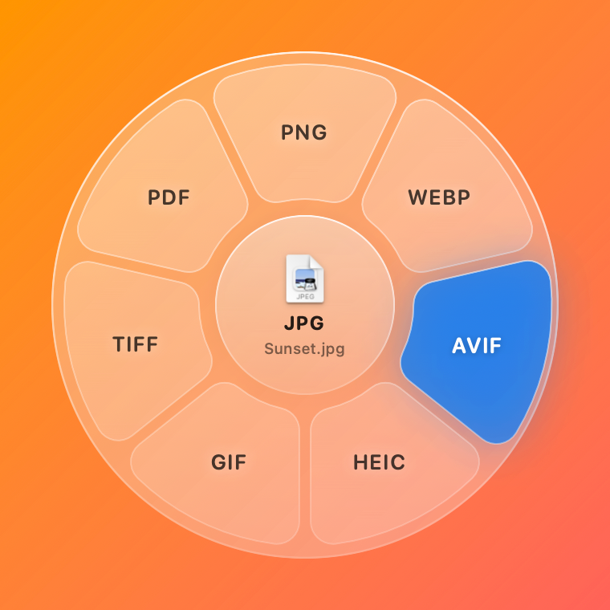
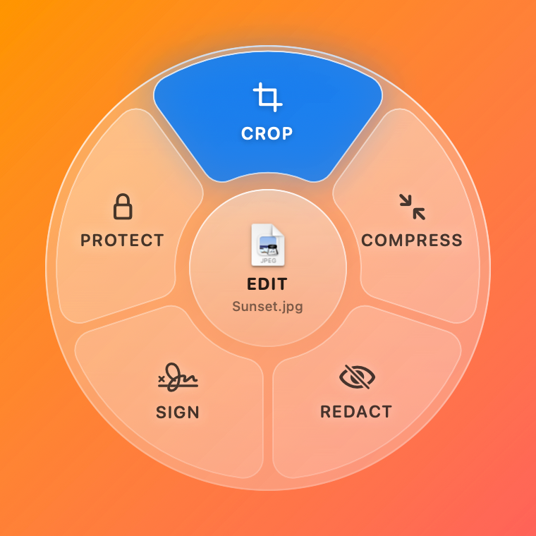
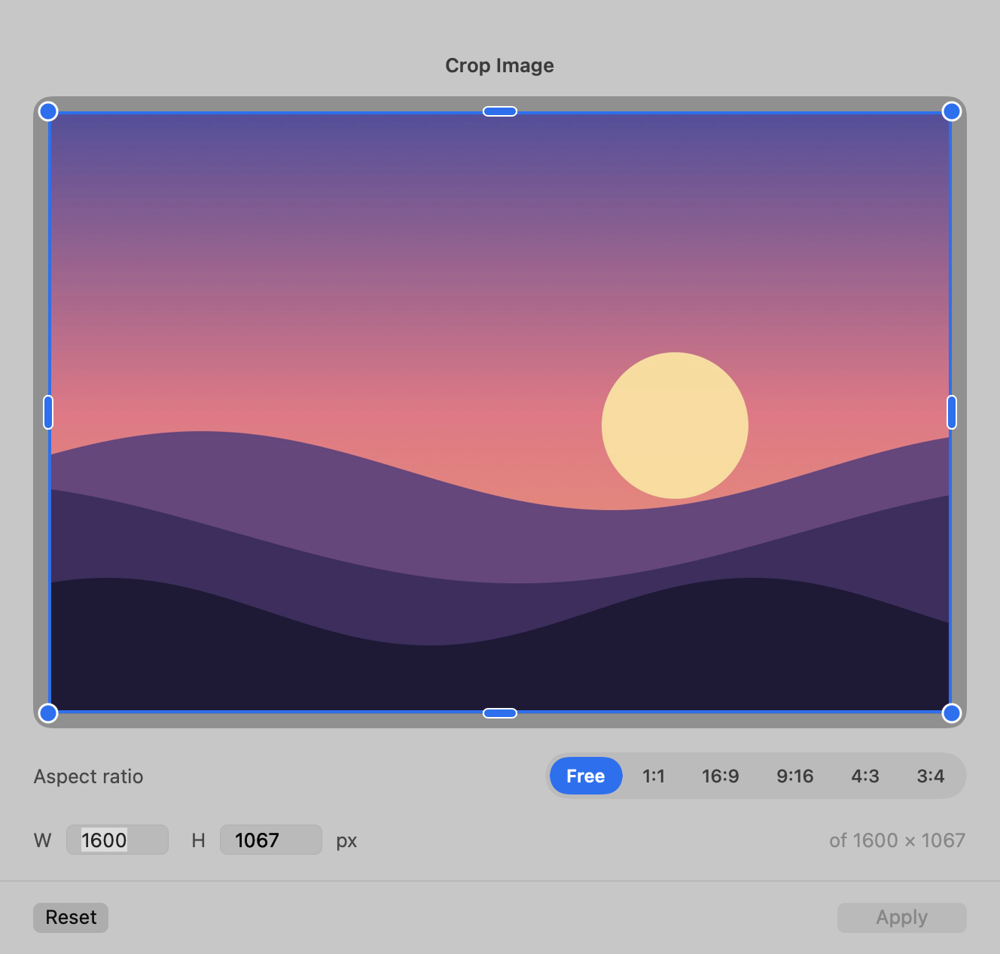
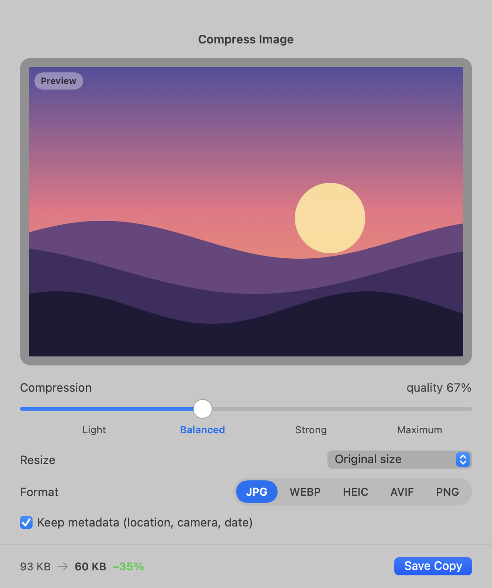
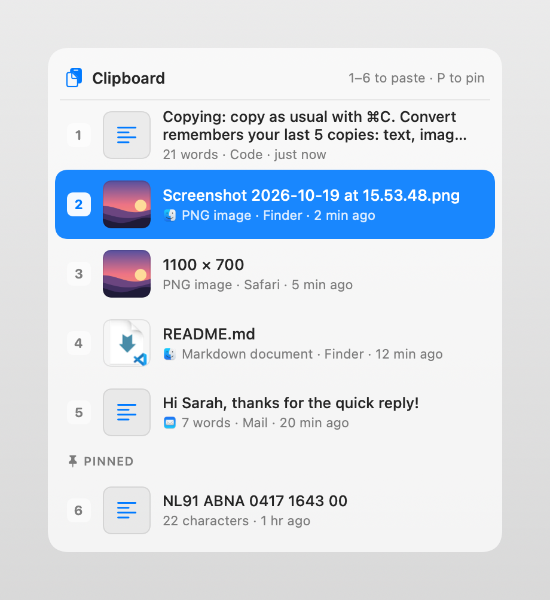

<p align="center">
  
</p>

<h1 align="center">Convert</h1>

<p align="center">
  <b>Convert, edit and sign files right from Finder, and paste from your clipboard history in any app.</b><br>
  A small menu bar app for macOS. Middle-click a file and pick a format from a glass wheel.
</p>

<p align="center">
  <a href="#install">Install</a> ·
  <a href="#converting-files">Converting</a> ·
  <a href="#editing-images-and-pdfs">Editing</a> ·
  <a href="#clipboard-history">Clipboard history</a> ·
  <a href="#supported-formats">Formats</a> ·
  <a href="#privacy">Privacy</a> ·
  <a href="#faq--troubleshooting">FAQ</a>
</p>

<p align="center">
  
  
</p>

## Highlights

- **Convert in one gesture.** Press the scroll wheel on a file, flick toward a format and let go. The converted copy appears next to the original.
- **Many formats.** Images (JPG, PNG, HEIC, WebP, AVIF, GIF, TIFF), documents (TXT, Markdown, RTF, Word, HTML, PDF) and tables (CSV, TSV, PSV, Excel, JSON).
- **Edit without opening an app.** ⌘ + middle-click an image or PDF to crop, compress, black out (redact), sign, add a date, pick pages or add a password.
- **Clipboard history.** Press ⌃⌥V anywhere to paste one of your last 5 copies, or one of up to 3 pinned items.
- **Safe by design.** Originals are never changed. Everything runs on your Mac, with no accounts, uploads or tracking.
- **Native and light.** A real macOS app for Apple Silicon and Intel, a 7 MB download. It lives in the menu bar, not the Dock.

## Install

### With Homebrew (recommended)

```sh
brew tap ricardobroeders/convert https://github.com/Ricardobroeders/convert
brew install --cask ricardobroeders/convert/convert
```

Update later with:

```sh
brew upgrade --cask convert
```

### With the disk image

1. Download the latest `Convert-x.y.z.dmg` from [Releases](https://github.com/Ricardobroeders/convert/releases/latest).
2. Open it and drag **Convert** onto **Applications**.
3. Open Convert from Applications.

Convert isn't notarized by Apple yet, so the first time you open the downloaded app, macOS says it can't verify it. Go to **System Settings › Privacy & Security**, scroll down and click **Open Anyway**. You only need to do this once. The Homebrew install skips this step.

### Requirements

- macOS 14 Sonoma or later
- Apple Silicon or Intel Mac

### First launch

Convert appears as an icon in the menu bar (top right), not in the Dock. It asks for two permissions, each the first time it's needed:

| Permission | Why | Where |
|---|---|---|
| **Automation → Finder** | To see which files you've selected in Finder | macOS asks automatically the first time you open the wheel |
| **Accessibility** | To catch the scroll-wheel click on a file and to paste from the clipboard history for you | System Settings › Privacy & Security › Accessibility → turn on **Convert** |

Without Accessibility, everything else still works. You use the keyboard shortcut instead of middle-click. When you pick something from the clipboard history, Convert puts it on the clipboard and you press ⌘V yourself.

## Converting files

Select one or more files in Finder and open the wheel in whichever way you like:

| How | What you do |
|---|---|
| **Mouse: press and flick** | Press and hold the scroll wheel on a file, move toward a format, let go |
| **Mouse: click and click** | Click the scroll wheel on a file, then click a format |
| **Keyboard: hold and flick** | Hold **⌃⌥C** (Control-Option-C), move the pointer toward a format, let go |
| **Keyboard: tap and pick** | Tap **⌃⌥C**, then click a format, press **1–8** (clockwise from the top), or use the arrow keys and Return |

Press **Esc** or click outside the wheel to cancel.

**What happens next**

- The converted copy is saved **next to the original**, with the new extension: `photo.jpg` → `photo.webp`.
- The original is **never changed or overwritten**. If `photo.webp` already exists, the new file is called `photo 2.webp`.
- **Several files at once:** select them all and every file is converted. If they're different types, the wheel shows only the formats all of them can become.
- **Middle-click acts like right-click:** on a file that's part of your selection, the whole selection is converted; on any other file, just that one.
- Middle-click is only taken over **on files in Finder**. Folders, the desktop background and every other app keep their normal middle-click.
- ⌃⌥C only works while Finder is the frontmost app, so other apps keep that shortcut. You can change it from the menu bar icon.

## Editing images and PDFs

**⌘ + middle-click** an image or PDF to open the edit wheel. Each tool opens a small window with a live preview and saves a **new copy**, such as `photo cropped.jpg`, `contract signed.pdf` or `report pages 1-3.pdf`.

| Tool | Images | PDFs |
|---|---|---|
| **Crop** | Drag the corners or edges. Choose Free, 1:1, 16:9, 9:16, 4:3 or 3:4, or type an exact width and height in pixels | – |
| **Pages** | – | Click pages in the order you want, or type ranges like `5, 1-3`, and save them as a new PDF |
| **Compress** | A slider from Light to Maximum, optional resize (3840 to 800 px), output format (JPG, WebP, HEIC, AVIF, PNG) and a choice to keep or strip metadata. The new file size updates live | The same slider recompresses and downsamples the images inside the PDF; text stays sharp and selectable |
| **Redact** | Drag black boxes over anything you want hidden. Metadata (location, camera) is removed from the copy | Black boxes on any page. Pages with boxes are flattened, so the hidden text is **really gone**, not just covered up |
| **Sign** | Place your signature and/or a date, drag to move, use the corner to resize | The same, on any page; the rest of the PDF stays untouched |
| **Protect** | Saved as a password-protected PDF | A password-protected copy (AES encryption) that asks for the password when opened |

<p align="center">
  
  
</p>

### Signatures and dates

- **Draw your signature once** with the mouse or trackpad on the signature pad (**+ New**). It's saved on your Mac and ready next time. You can keep several, and right-click one to delete it.
- **Add a date** with the **Date** tile. It's today by default, but you can pick any date. Choose a style: `19-10-2026`, `19 October 2026` or `2026-10-19`. It follows your Mac's language, so Dutch gives `19 oktober 2026`. Changing the date or style updates dates you've already placed.
- Signatures are stored only in `~/Library/Application Support/Convert/Signatures` and never leave your Mac.

This makes it quick to sign contracts, addenda and forms: ⌘ + middle-click the PDF, choose **Sign**, click your signature and the date, put them in place and save.

### Passwords

Choose a password of at least 4 characters and type it twice. A strength meter shows how strong it is. The copy opens in Preview, Adobe Reader, browsers and other PDF readers after entering the password. Convert doesn't keep the password, so **write it down**: a forgotten password can't be recovered.

## Clipboard history



Copy as usual with ⌘C. Convert remembers your **last 5 copies**: text, images and screenshots, files from Finder, and formatted text.

Press **⌃⌥V** (Control-Option-V) in **any app** and a list opens at the pointer, newest first. Each row shows:

- a preview (the actual picture for copied images and screenshots),
- the text or file name,
- what it is, which app it came from, and how long ago.

**Pasting**

- **Hold ⌃⌥V**, move over a row and let go, or
- press **1–5**, or use **↑/↓** and **Return**, or click a row.

The item is pasted straight into the app you're working in and moves to the top. A plain ⌘V then pastes it again. ⌘V itself never changes: it always pastes your latest copy.

**Pinning**

Right-click a row, or highlight it and press **P**, to pin it. Use this for things you paste often, like your address, IBAN or a standard reply. Up to **3 pinned items** stay in a *Pinned* section (#6–8) no matter how much you copy afterwards.

**Privacy**

- The history is kept **in memory only**. It's never written to disk and disappears when Convert quits.
- Copies that password managers mark as secret are **never recorded**. That includes 1Password, Bitwarden, Apple's Passwords app and others that follow the [nspasteboard.org](http://nspasteboard.org) convention.
- Turn recording off with **Remember Copies** in the menu, or empty it with **Clear Clipboard History**.

<br clear="right">

## Supported formats

### Images

| From | To |
|---|---|
| **JPG** | PNG · WebP · AVIF · HEIC · GIF · TIFF · PDF |
| **PNG** | JPG · WebP · AVIF · HEIC · GIF · TIFF · PDF |
| **HEIC** (iPhone photos) | JPG · PNG · WebP · AVIF · TIFF · PDF |
| **WebP** | JPG · PNG · AVIF · HEIC · GIF · PDF |
| **AVIF** | JPG · PNG · WebP · HEIC · PDF |
| **GIF** | PNG · JPG · WebP · AVIF · PDF |
| **TIFF** | JPG · PNG · WebP · AVIF · HEIC · PDF |
| **BMP, RAW, PSD** and other images macOS can open | JPG · PNG · WebP · AVIF · HEIC · TIFF · PDF |

- The photo's rotation is applied, so pictures never come out sideways.
- Camera and location data is kept for JPG, HEIC, PNG and TIFF.
- Transparent areas become white in JPG.

### Documents and text

| From | To |
|---|---|
| **TXT** | Word (DOCX) · PDF · Markdown · RTF · HTML · JSON · CSV · JS |
| **Markdown** (MD) | Word · PDF · HTML · RTF · TXT |
| **Word** (DOCX) | PDF · TXT · RTF · HTML · ODT |
| **Word 97–2003** (DOC), **OpenDocument** (ODT) | DOCX · PDF · TXT · RTF |
| **RTF** | DOCX · PDF · TXT · HTML · ODT |
| **HTML** | PDF · DOCX · TXT · RTF |
| **JavaScript** (JS) | PDF · HTML · DOCX · RTF · TXT |
| **PDF** | PNG · JPG · WebP (one image per page) · TXT · DOCX · RTF |

- **Markdown:** headings, lists, bold, italics, links, quotes and code blocks are kept as real formatting in Word, PDF and HTML.
- **Code and JSON:** turned into a monospaced document with syntax colours.

### Tables and data

| From | To |
|---|---|
| **CSV** | Excel (XLSX) · TSV · PSV · JSON · PDF · DOCX · HTML · Markdown |
| **TSV** (tab-separated) | Excel · CSV · PSV · JSON · PDF · DOCX · HTML · Markdown |
| **PSV** (pipe-separated) | Excel · CSV · TSV · JSON · PDF · DOCX · HTML · Markdown |
| **Excel** (XLSX) | CSV · TSV · PSV · JSON · PDF · DOCX · HTML · Markdown |
| **JSON** | CSV · Excel · TSV · PSV · PDF · HTML · TXT |

- **Separators are detected automatically:** comma, semicolon (common in Dutch and European Excel exports), tab or pipe.
- **Numbers stay numbers** in Excel and JSON, while codes with leading zeros (`007`, postcodes) stay text.
- **Excel workbooks with several sheets** give one file per sheet: `report - Sheet2.csv`.
- **Excel values come through clean:** dates become real dates (`2026-10-19`), formulas give their calculated value, and rounding noise like `0.30000000000000004` becomes `0.3`.
- **PDF and Word get a proper table** with a header row, switching to landscape when there are more than 6 columns.
- **JSON → table:** a list of objects becomes rows, with columns in the order they appear in the file.

## The menu bar icon

Click the Convert icon in the menu bar for:

| Menu item | What it does |
|---|---|
| **Convert Finder Selection…** | Opens the wheel for the files selected in Finder |
| **Change Shortcut…** | Pick another shortcut instead of ⌃⌥C |
| **Middle-Click Files to Convert** | Turn the scroll-wheel trigger on or off |
| **Paste from Clipboard History** | Opens the clipboard list |
| **Remember Copies** | Turn clipboard history on or off |
| **Clear Clipboard History** | Forget all copies, including pins |
| **Open at Login** | Start Convert automatically when you log in |
| **Quit Convert** | Quit the app |

## Privacy

Convert works entirely on your Mac.

- **No network.** Files are converted locally with macOS's own frameworks plus the open-source libwebp and libavif libraries. Nothing is uploaded, and there are no accounts, analytics or ads.
- **Originals are never touched.** Every conversion and edit writes a new file next to the original.
- **Redaction is real.** Redacted areas are removed from the pixels (images) or the page is flattened (PDF), so the text underneath can't be selected or recovered.
- **Signatures** are stored only in your user folder, `~/Library/Application Support/Convert/Signatures`.
- **Clipboard history** is kept in memory only and skips anything password managers mark as secret.

## FAQ & troubleshooting

**Where is my converted file?**
In the same folder as the original, with the same name and the new extension. A short confirmation appears when it's done.

**Middle-click doesn't do anything.**
Allow Convert in **System Settings › Privacy & Security › Accessibility**. If it's already on, toggle it off and on again, or remove Convert with the **–** button and add it again. Check that middle-click is enabled in the Convert menu. It only works on files in Finder, not on folders or in other apps.

**I don't have a mouse with a scroll wheel.**
Select files in Finder and press **⌃⌥C**. Everything else works the same.

**⌃⌥C does nothing.**
The shortcut only works while Finder is the active app. The first time, macOS asks whether Convert may control Finder; if you clicked *Don't Allow*, turn it on in **System Settings › Privacy & Security › Automation › Convert › Finder**.

**Picking from the clipboard history doesn't paste.**
Pasting for you needs the Accessibility permission. Without it, the item is put on the clipboard and you press ⌘V.

**"Convert can't be opened because Apple cannot check it for malicious software."**
This happens with the DMG download because the app isn't notarized yet. Open **System Settings › Privacy & Security** and click **Open Anyway**, once. Installing with Homebrew avoids it.

**Which formats appear in the wheel?**
The formats the selected file (or *every* selected file) can become. The wheel shows up to 8 options; see [Supported formats](#supported-formats).

**Can I convert many files at once?**
Yes: select them all in Finder and middle-click one of them, or press ⌃⌥C.

## Command line

The app can also convert files from Terminal or scripts:

```sh
/Applications/Convert.app/Contents/MacOS/Convert --convert webp ~/Desktop/*.png
/Applications/Convert.app/Contents/MacOS/Convert --convert xlsx export.csv
```

## Uninstall

```sh
brew uninstall --cask convert            # add --zap to also remove its settings
```

Or quit Convert from the menu bar and drag it from Applications to the Trash. Saved signatures stay in `~/Library/Application Support/Convert` until you delete that folder.

## About this repository

This repository holds the [Homebrew](https://brew.sh) cask (`Casks/convert.rb`) and the [releases](https://github.com/Ricardobroeders/convert/releases) with the disk images. Each release lists what's new.
